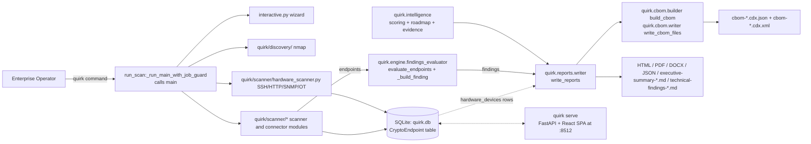
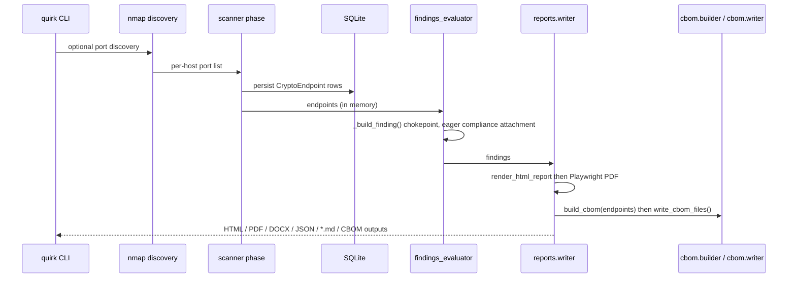
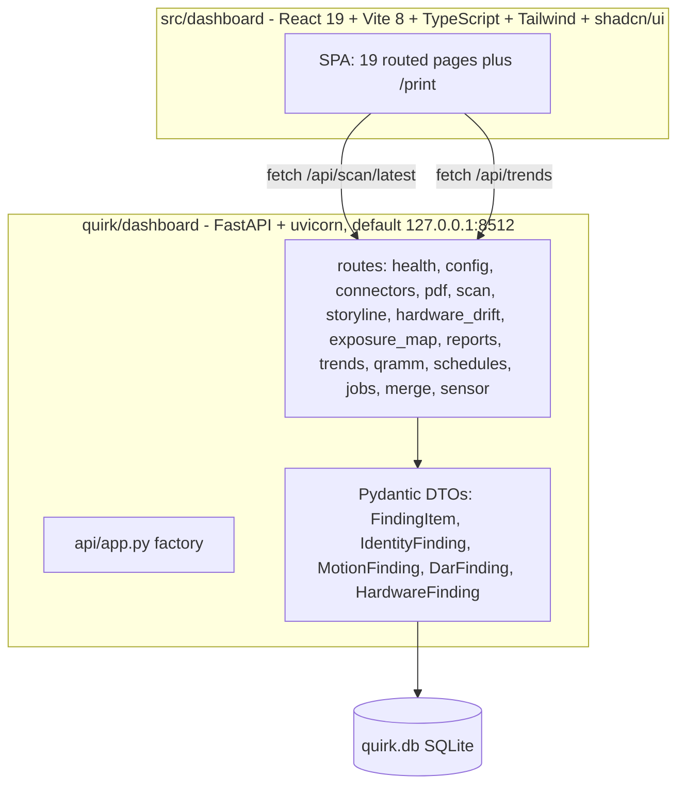

# QU.I.R.K. — Architecture Reference

*(Audience: enterprise architects, security reviewers, and consultants evaluating QU.I.R.K. before deployment. This document is a runtime-and-trust-model reference, not a contributor code tour. It assumes no prior reading of the codebase.)*

---

## 1. System Overview

QU.I.R.K. (Quantum Infrastructure Readiness Kit) is a **single-host Python CLI** that runs as a privileged operator from a workstation or jump host, performs cryptographic posture scans against operator-supplied targets, persists findings to a local SQLite database, and emits CycloneDX CBOM plus HTML / PDF / DOCX / JSON / Markdown reports (PDF requires Playwright and DOCX requires the `[docx]` extra; without them the HTML report is still written). An optional FastAPI dashboard (`quirk serve`) serves that same SQLite database at `127.0.0.1:8512` by default; it is a viewer for scan results that also hosts the scan-launch, schedule, QRAMM and sensor endpoints (see §6).

QUIRK is **outbound-only at scan time** (it reaches scan targets and optionally a chaos lab) and binds **loopback by default when serving the dashboard**. There is no telemetry, no phone-home, no QUIRK-operated cloud component. All artifacts — database, reports, CBOM — live in the operator's working directory.

The CLI entry point is registered via `pyproject.toml` `[project.scripts]` as `quirk = "run_scan:_run_main_with_job_guard"`, a thin wrapper that calls `main()` and marks the job failed on an unhandled exception. `run_scan.py:1248` (`def main():`) is the argparse entry; subcommand routing (`init`, `serve`, `compliance` and the other subcommands) is handled inside `main()` (see §9).

---

## 2. Trust Boundaries and Network Surface

QUIRK runs as the operator's identity on the operator's workstation. It crosses three trust boundaries:

1. **Operator → scan target.** Outbound TLS, SSH, SMTP, AMQP, LDAP, DNS, HTTP, etc. directed at the operator-supplied target list. QUIRK does not pivot and does not exploit; the opt-in `--fuzz` REST mode sends active probe requests only after an interactive confirmation. Each probe sets a connect/read timeout; the per-phase timeout and retry settings are listed in [`docs/timeout-retry-audit.md`](timeout-retry-audit.md).
2. **Operator → cloud control plane (optional).** AWS / Azure / GCP / Vault / Kubernetes connectors call cloud APIs over TLS using the operator's existing identity (see credential matrix below). QUIRK's connector modules make no create, put, delete or update calls against cloud resources — describe / list / get only.
3. **Dashboard → operator browser.** `quirk serve` binds `127.0.0.1:8512` (loopback) by default and serves a single-page application backed by FastAPI. With the default loopback bind and no API token configured (neither `QUIRK_API_TOKEN` nor `security.api_token` in the config file named by `QUIRK_CONFIG_PATH`, default `./config.yaml`), the API runs with operator authentication disabled, because only local processes can reach it. `--host` can bind a network-reachable interface; `quirk serve` then refuses to start unless a token is configured (bearer-token auth is enforced on the API when a token is configured) or the operator passes `--insecure` to opt out explicitly.

QUIRK has **no inbound surface** outside of `quirk serve` (which also hosts the sensor-push endpoint used by distributed sensors) and **no outbound telemetry** of any kind. There is no automatic updater. There is no cloud sync. The database, reports, and CBOM never leave the working directory unless the operator copies them, pushes sensor results to a console (`quirk sensor push`), exports findings to a SIEM (`quirk export --siem`), or configures an outbound notification or ticketing integration.

### Connector Credential Storage Matrix

QUIRK reads credentials at scan time from sources outside the QUIRK process and **does not persist credential values to `quirk.db`, the CBOM, the dashboard API or the PDF export** (a sentinel-credential regression suite checks each of those surfaces). Findings reference the scanned resource (e.g., an AWS resource ARN, the Vault address and mount path, a Kubernetes namespace) but never the secret material that authorized the call.

| Connector | Credential Source | Where Stored | QUIRK Persists Credential? |
|-----------|-------------------|--------------|----------------------------|
| AWS | `~/.aws/credentials` profile (boto3 default chain; configurable via `connectors.aws_profile`) | Filesystem outside QUIRK | No |
| Azure | `DefaultAzureCredential` chain (env vars, managed identity, `az` CLI cache, etc.) | OS / cloud identity provider | No |
| GCP | Application Default Credentials (ADC) | OS / metadata server | No |
| Vault | `VAULT_TOKEN` env var (or `connectors.vault_token` config) | Env or config file | No (read once per run) |
| Kerberos | None — the scanner sends an unauthenticated AS-REQ to the KDC to enumerate encryption types | n/a | n/a |
| Database (Postgres / MySQL) | `connectors.pg_scanner_password` / `mysql_scanner_password` in `config.yaml` | Plaintext in config file ⚠ | No (rotate per engagement; least-privilege read-only DB user recommended) |
| Kubernetes | kubeconfig (default `~/.kube/config`, override `connectors.k8s_kubeconfig`) | Filesystem outside QUIRK | No |
| Container image (SBOM) | Image reference passed to `syft`; any registry authentication is `syft`'s own, outside QUIRK | Outside QUIRK | No |
| Source code (semgrep) | Local repository path passed to `semgrep`; QUIRK does not clone or authenticate | Filesystem | No |

The database connector passwords (`connectors.pg_scanner_password`, `connectors.mysql_scanner_password`) and the optional `connectors.vault_token` are the credential sources that can land plaintext in a QUIRK-owned config file; the `connectors` section also holds other credential fields such as `adcs_password` and SNMPv3 credentials. Operators should treat `config.yaml` as a secret artifact for the engagement and pair it with a least-privilege, read-only scanner database account.

---

## 3. Scanner Phase Model

Each scanner phase in the table below runs inside `_phase_timer(run_stats, name)` (`run_scan.py:269`), and each one not marked "timer only" is wrapped by `_wrapped_phase(...)` (`run_scan.py:287`). The `--enable-snmp` hardware sweep that follows the PQC probe is outside both: it catches only `ImportError` and per-host SNMPv3 probe errors itself. The wrapper is the firewall: any exception other than `KeyboardInterrupt` / `SystemExit` raised inside one scanner is converted into an error `CryptoEndpoint` row instead of crashing the run, and missing-extra advisories (e.g., `pip install quirk-scanner[cloud]` not installed) surface as findings rather than tracebacks. This is what lets QUIRK ship a single CLI that can be partially installed and still produce a coherent report.

The scanner and connector phases, grouped by family, are listed below. Each is a `_wrapped_phase(run_stats, "<phase name>", ...)` call site unless noted; the line number is the call site, and the phase name is the symbol to grep for if it has moved.

| Phase Wrapper Site | Module | Purpose |
|--------------------|--------|---------|
| `run_scan.py:2507` / `:2219` (`_phase_timer(run_stats, "discovery")`, timer only) | `quirk/discovery/nmap_provider.py`, `nmap_parser.py`, `coverage.py` | Optional nmap port discovery |
| `run_scan.py:2586` (`_phase_timer(run_stats, "fingerprinting")`, timer only) | `quirk/scanner/fingerprint.py` + `target_expander.py` | Pre-scan target enumeration / fingerprinting |
| `run_scan.py:2712` (`"tls_scanning"`) | `quirk/scanner/tls_scanner.py` | TLS protocol + cipher + cert inventory |
| `run_scan.py:2768` (`"ssh_scanning"`) | `quirk/scanner/ssh_scanner.py` | SSH kex / hostkey / cipher inventory (the SSH-banner hardware fingerprint, `fingerprint_hardware`, is called from this stage) |
| `run_scan.py:2866` (`"pqc_probe"`) | `quirk/scanner/pqc_probe.py` | Hybrid ML-KEM TLS probe |
| `run_scan.py:3170` (`"jwt_scanning"`) | `quirk/scanner/jwt_scanner.py` | JWT / API token algorithm inventory |
| `run_scan.py:3189` (`"container_scanning"`) | `quirk/scanner/container_scanner.py` | Crypto-library inventory of container images: runs syft, keeps only packages on its crypto-library allowlist (one `CONTAINER` endpoint each), and discards the rest of syft's package list (no SBOM is written) |
| `run_scan.py:3208` (`"source_scanning"`) | `quirk/scanner/source_scanner.py` | semgrep-driven source-code crypto detection |
| `run_scan.py:3234` / `:3287` (`"openapi_scanning"`, `"fuzz_scanning"`) | `quirk/scanner/openapi_scanner.py`, `rest_fuzzer.py` | OpenAPI spec crypto inventory; opt-in REST fuzzing |
| `run_scan.py:3634` (`"dnssec_scanning"`) | `quirk/scanner/dnssec_scanner.py` | DNSSEC algorithm chain inspection |
| `run_scan.py:3679` (`"kerberos_scanning"`) | `quirk/scanner/kerberos_scanner.py` | KDC enctype inventory |
| `run_scan.py:3657` (`"saml_scanning"`) | `quirk/scanner/saml_scanner.py` | SAML IdP signature / encryption inventory |
| `run_scan.py:3712` / `:3750` / `:3786` (`"smime_scanning"`, `"adcs_scanning"`, `"codesign_scanning"`) | `quirk/scanner/smime_scanner.py`, `adcs_scanner.py`, `codesign_scanner.py` | S/MIME, AD CS and code-signing certificate inventory |
| `run_scan.py:3905` (`"email_scanning"`) | `quirk/scanner/email_scanner.py` | SMTP / IMAP / POP3 TLS inventory: STARTTLS on 25 / 587 / 143 / 110, implicit TLS on 465 / 993 / 995 |
| `run_scan.py:3990` (`"broker_scanning"`) | `quirk/scanner/broker_scanner.py` | Kafka / RabbitMQ (AMQP) / Redis / Azure Service Bus / AWS SQS broker TLS inventory |
| `run_scan.py:3338` / `:3363` / `:3384` / `:3444` / `:3603` / `:3837` (`"aws_scanning"`, `"azure_scanning"`, `"gcp_scanning"`, `"db_scanning"`, `"k8s_scanning"`, `"vault_scanning"`) | `quirk/scanner/{aws,azure,gcp}_connector.py`, `db_connector.py`, `k8s_connector.py`, `vault_connector.py` | Cloud KMS + database + cluster + secrets vault posture |
| `run_scan.py:3520` / `:3549` (`"s3_scanning"`, `"blob_scanning"`) | `quirk/scanner/aws_connector.py`, `azure_connector.py` | S3 and Azure Blob storage encryption posture |
| `run_scan.py:818` (`"ot_ics_supplemental"`) | `quirk/scanner/hardware_scanner.py` | OT/ICS-only supplemental fingerprinting |
| `run_scan.py:4076` (`_phase_timer(run_stats, "risk_engine")`, timer only) | `quirk/engine/findings_evaluator.py` (`evaluate_endpoints`) | Finding synthesis (runs after every scanner phase) |

See [`docs/timeout-retry-audit.md`](timeout-retry-audit.md) for the per-phase `TimeoutsCfg` + `RetryCfg` policy table.

---

## 4. Data Flow: Scan → DB → CBOM → Reports

Within a single `quirk` invocation, data moves through five transitions: **discovery → scanner endpoints (persisted to SQLite) → risk synthesis → report rendering → CBOM build**. Scanner output is held in memory as `CryptoEndpoint` objects, flushed to the database after most scanner stages and merged in a final `db_persist` phase; `evaluate_endpoints()` synthesises findings from those in-memory endpoints, and `write_reports()` then renders every report from the endpoints and findings and builds the CBOM last.

Compliance attachment is **eager** at `_build_finding()` in `quirk/engine/findings_evaluator.py` (Phase 49 D-02) — every emitted finding carries its `compliance:` field (looked up with `quirk.compliance.normalize_finding_title`) as soon as it leaves the risk engine; HTML / PDF renderers read what is already there rather than joining late. This is the single most important invariant in the data flow: a finding is born compliance-aware.

See also: [`docs/cbom-guide.md`](cbom-guide.md), [`docs/intelligence-schema.md`](intelligence-schema.md).

---

## 5. SQLite Schema

QUIRK persists scanner output to a single local SQLite file (`quirk init` generates a `config.yaml` that sets it to `./quirk-output/quirk.db`). The schema is one declarative base with `crypto_endpoints` as the central table plus supporting tables for scans, schedules, QRAMM, sensors, remediation and hardware lifecycle.

- **Models module:** `quirk/models.py` defines a single `declarative_base()` and 21 ORM classes. The central class is `class CryptoEndpoint` (table name: `crypto_endpoints`). Every scanner — TLS, SSH, JWT, container, source, DNSSEC, Kerberos, SAML, email, broker, plus all cloud / DB / k8s / Vault connectors — writes to this table. The other classes cover QRAMM (`qramm_sessions`, `qramm_answers`, `qramm_profiles`), scheduling (`scheduled_scans`, `scheduled_runs`), scan jobs and checkpoints (`scan_jobs`, `scan_checkpoints`, `scan_phase_records`), sensors (`sensors`, `sensor_tokens`, `sensor_pushes`, `merge_runs`), integrations (`integration_deliveries`), hardware (`hardware_devices`, `hardware_drift_events`, `vendor_pqc_trend_events`) and remediation (`remediation_items`, `remediation_item_fingerprints`, `remediation_closure_events`, `scan_scope_signatures`).
- **Migrations:** `quirk/db.py` uses a generic `_ensure_columns(engine, table, columns)` helper, invoked from both `init_db()` and the public `run_additive_migration()` orchestrator. Column migrations are **additive only** — they add missing columns and never drop or rename one — which keeps an older database file readable by a newer QUIRK without an offline migration step. The one exception is `_ensure_qramm_profiles_fk`, which rebuilds the `qramm_profiles` table once to retrofit a foreign key. Separate table-level `_ensure_*_table(s)` helpers create new tables on first boot, among them `_ensure_qramm_tables`, `_ensure_scheduled_tables`, `_ensure_scan_jobs_table`, `_ensure_scan_checkpoints_table`, `_ensure_integration_deliveries_table`, `_ensure_merge_runs_table`, `_ensure_hardware_drift_events_table`, `_ensure_remediation_tables` and `_ensure_scan_phase_records_table`.
- **Per-scanner large payloads:** Scanners that produce nested structures (jwt, container, source, cloud, kerberos, saml, dnssec, smime, codesign, adcs, gcs, dat, email, broker) serialize to `*_scan_json` Text columns on `crypto_endpoints`. The email scanner attaches its per-host summary JSON to the lowest-port endpoint of each host, so a host yields one email summary regardless of how many ports were probed.

The result is a database that survives version upgrades in place and that can be opened by any SQLite client for ad-hoc post-scan analysis.

---

## 6. Dashboard Architecture

The dashboard is a two-tier viewer over `quirk.db`: a React single-page application and a FastAPI backend. It reads scan results from the database and also hosts endpoints that write to it (scan jobs, schedules, QRAMM sessions, sensor pushes).

- **Frontend.** `src/dashboard/` is a Vite 8 + React 19 + TypeScript + Tailwind + shadcn/ui SPA with 19 routed pages (listed below), plus a chrome-free `/print` page that `App.tsx` serves outside the routed shell: `/` (executive), `/findings`, `/identity`, `/motion`, `/hardware`, `/data-at-rest`, `/certificates`, `/cbom`, `/roadmap`, `/exposure-map`, `/trends`, `/qramm`, `/qramm/assessment`, `/schedules`, `/scan/new`, `/scan/job/:jobId`, `/scans`, `/sensors`, `/compare`. A conditional vertical-specific route is also registered at runtime when the active vertical provides a page component. The built bundle is **committed under `quirk/dashboard/static/`** so `quirk serve` ships the UI without requiring a node toolchain on the target host — air-gap friendly.
- **Backend.** `quirk/dashboard/server.py` exposes `quirk serve` (dispatched at `run_scan.py:1268`, `_sys.argv[1] == "serve"`). `quirk/dashboard/api/app.py` is the FastAPI factory; routes live in fifteen modules under `quirk/dashboard/api/routes/` (`health.py`, `config.py`, `connectors.py`, `pdf.py`, `scan.py`, `storyline.py`, `hardware_drift.py`, `exposure_map.py`, `reports.py`, `trends.py`, `qramm.py`, `schedules.py`, `jobs.py`, `merge.py`, `sensor.py`). DTOs (`FindingItem`, `IdentityFinding`, `MotionFinding`, `DarFinding`, `HardwareFinding`, etc.) are Pydantic models that shape the SQLite rows for SPA consumption.
- **Persistence.** Most dashboard endpoints only read `quirk.db`. The endpoints that write to it are `POST`/`DELETE /api/jobs`, `POST`/`PATCH`/`DELETE /api/schedules`, the `/api/qramm/*` session, profile and draft endpoints, and `POST /api/sensor/push`; `POST /api/export/pdf` renders a PDF and writes nothing to the database. Scan results themselves are written by `quirk` scan runs.
- **Bind address.** `quirk serve` defaults to `127.0.0.1:8512`. Loopback is the default security boundary; `--host` selects another interface and, on a non-loopback bind, `quirk serve` refuses to start without an API token (`QUIRK_API_TOKEN` or `security.api_token`) unless `--insecure` is passed.

---

## 7. CBOM Pipeline

QUIRK produces a CycloneDX 1.6 CBOM as a first-class output, not an afterthought.

- **Build.** `quirk/cbom/builder.py::build_cbom(endpoints, hw_devices=None, remediation_items=None) -> Bom` consumes the same `CryptoEndpoint` rows that feed the risk engine (plus hardware devices and remediation items when supplied), classifies each algorithm reference via `quirk/cbom/classifier.py`, and emits a CycloneDX 1.6 `Bom` object.
- **Write.** `quirk/cbom/writer.py::write_cbom_files()` serializes that `Bom` to `cbom-<stamp>.cdx.json` and `cbom-<stamp>.cdx.xml` in the report output directory.
- **Coverage report.** Algorithm coverage is regenerable via `tests/test_cbom_classifier_coverage.py::test_regenerate_coverage_report` (a slow test that runs only with `REGEN_CBOM_COVERAGE=1`), producing `docs/cbom-classifier-coverage.md`.

The classifier's PQC entries use the **FIPS-finalized algorithm names**: FIPS 203 (ML-KEM), FIPS 204 (ML-DSA), FIPS 205 (SLH-DSA). SLH-DSA entries are keyed by security level (`slh-dsa-128`, `slh-dsa-192`, `slh-dsa-256`), not by FIPS 205 parameter-set names, so a name such as `SLH-DSA-SHA2-128s` classifies as unknown. Pre-standardization draft algorithm names are not in the classifier table. The table also carries the non-FIPS hybrid `sntrup761x25519`.

See also: [`docs/cbom-guide.md`](cbom-guide.md), [`docs/cbom-classifier-coverage.md`](cbom-classifier-coverage.md).

---

## 8. Reports Pipeline

Reports are rendered through a single orchestrator; the HTML and PDF reports share a single Jinja template, and the DOCX and Markdown outputs have their own renderers.

- **Orchestrator.** `quirk/reports/writer.py::write_reports()` is the entry point scan runs use to build report artifacts; it owns the output directory layout and timestamps. (The sensor-merge path in `quirk/merge/scan.py` builds its CBOM separately via `build_cbom`.)
- **Template.** `quirk/reports/templates/report.html.j2` is the single Jinja template shared by HTML and PDF outputs. PDF is rendered by Playwright headless Chromium against the same HTML — there is no second template to drift. If Playwright is unavailable the HTML report is still written and the PDF is skipped.
- **Markdown and other outputs.** `executive-summary-<stamp>.md` and `technical-findings-<stamp>.md` (plus `scorecard-<stamp>.md` and `roadmap-<stamp>.md`) render alongside the HTML / PDF / DOCX reports for paste-into-Confluence / paste-into-Jira workflows; `write_reports()` also writes `findings-<stamp>.json` and `intelligence-<stamp>.json`.
- **Versioned constants.** `quirk/reports/writer.py` imports `PLATFORM_VERSION` dynamically from the package (`from quirk import __version__ as PLATFORM_VERSION`) so it always reflects the installed package version. `SCHEMA_VERSION = 2` is a hardcoded integer defined in the same module, but it is not currently written into any report file. The intelligence JSON embeds `intelligence_version` (equal to `PLATFORM_VERSION`) as a top-level field, and the CLI scan summary table prints `PLATFORM_VERSION`.

---

## 9. Subcommand Routing (CLI)

Every `quirk <subcommand>` reaches `run_scan:main` through the `_run_main_with_job_guard` entry point. Subcommands are dispatched **inside** `main()` by an argv sniff (`_sys.argv[1] == "<name>"`) rather than registered as argparse subparsers. `main()` handles `init` (`run_scan.py:1251`), `serve` (`:1268`, dispatched to `quirk.dashboard.server.serve`), `compliance` (`:1314`), `doctor` (`:1369`), `schedule` (`:1375`), `scheduler` (`:1381`), `qramm` (`:1387`), `cve` (`:1395`), `analyze-token` (`:1403`), `token` (`:1409`), `export` (`:1415`), `ticket` (`:1421`), `sensor` (`:1427`), `console` (`:1433`), `errors` (`:1439`), `report` (`:1445`) and `db` (`:1451`); anything else falls through to the scan argparse parser. This is intentional: it keeps a single argparse surface for scan options and avoids a subparser tree that would force scan flags onto the auxiliary commands.

The practical implication for operators: every `quirk <subcommand>` invocation goes through the same entry function.

---

## 10. Versioning and Versioned Constants

QUIRK keeps three versioned constants in `quirk/reports/writer.py`:

- `PLATFORM_VERSION` — dynamically imported from the package (`from quirk import __version__ as PLATFORM_VERSION`); resolves to the installed package version at runtime (for example `5.25.0` for the 5.25.0 release).
- `SCHEMA_VERSION = 2` — a hardcoded integer constant; no report file embeds it today.
- `INTELLIGENCE_VERSION` — assigned from `PLATFORM_VERSION` so it tracks the platform version automatically.

---

## 11. References

- [`docs/quirk-overview.md`](quirk-overview.md) — high-level pitch and product framing.
- [`docs/cbom-guide.md`](cbom-guide.md) — CBOM citation language and consumer guidance.
- [`docs/cbom-classifier-coverage.md`](cbom-classifier-coverage.md) — algorithm coverage report.
- [`docs/intelligence-schema.md`](intelligence-schema.md) — finding / scoring schema.
- [`docs/timeout-retry-audit.md`](timeout-retry-audit.md) — per-phase timeout / retry policy.
- [`docs/operators-guide.md`](operators-guide.md) — install, configure, scan, troubleshoot, per-scanner reference.

---

## 12. Hardware Scanning

QU.I.R.K. identifies network infrastructure devices — routers, firewalls, load balancers, HSMs, and management controllers — using a cascade of signals, each requiring progressively more network access (SSH banner, HTTP management interface, SNMP), with Modbus and BACnet probes added for OT/ICS devices. Hardware scanning is a parallel signal path to the cryptographic protocol scanners; its findings are stored in the same SQLite database and emitted in the same CBOM output, but through dedicated modules in `quirk/scanner/` (`hardware_scanner.py`, `hardware_meta.py`, `hardware_tier.py`). The SNMP signal, and the OT/ICS probes, require the optional `[hw]` extras (`pip install 'quirk-scanner[hw]'`); the SSH-banner and HTTP signals do not.

### Signal Chain

For each device the scanner attempts identification in order; HTTP is tried only when the SSH banner did not identify a vendor, and SNMP only when neither did. Separately, with `--enable-snmp` a bulk SNMP sweep queries every host seen by the TLS, SSH and PQC phases; a response fills in a device whose vendor is still `Unknown`, or creates an SNMP-only device record:

1. **SSH banner** — SSH server version strings (e.g., `SSH-2.0-Cisco-1.25`) are matched against a curated vendor/model pattern table. Requires only TCP/22 access; no credentials needed.
2. **HTTP management interface** — HTTP responses from well-known management ports are fingerprinted against vendor header and title patterns. Requires TCP access to management ports; no credentials needed.
3. **SNMP probe** — Sent whenever the SSH banner and HTTP signals left the vendor unidentified and the `[hw]` extra (pysnmp) is installed, whether or not `enable_snmp` is on; `--enable-snmp` / `connectors.enable_snmp` switches on only the separate bulk sweep described above. Three OIDs are retrieved via SNMPv2c by default (or SNMPv3 USM when a per-host or `default` `snmp_v3_credentials` entry is configured): `sysDescr` (full device description string), `sysName` (configured hostname), and `sysObjectID` (enterprise OID tree). The response is parsed first by the `sysdescrparser` library and then by a vendor regex fallback when library parsing yields no match. Requires UDP/161 access and a read-only community string. This per-device step always sends the community `public`; the `connectors.snmp_community` key in `config.yaml` (default `public`) is read only by the bulk sweep. The read-only community string is the trust-boundary contract: the SNMP scanner issues only GET and table-walk requests.

Each device receives a confidence grade (`high`, `medium`, `low`, or `unknown`). A matrix match is graded `high` when the matched text carries a model or version token and `medium` when only the vendor pattern matched; an SSH banner with no matrix match is graded `low`; a vendor parsed from an SNMP `sysDescr` starts at `medium`, and a matrix match on that text is then graded by the same rule.

### Hardware Remediation Tiers

Devices identified by the per-device signal chain (and by the OT/ICS supplement) are classified by `assign_tier()` into one of QUIRK's remediation tiers (`quirk/scanner/hardware_tier.py`), which reflect its quantum-readiness migration path. A device created only by the bulk SNMP sweep is stored as `Tier N/A` without passing through `assign_tier()`. The 2030 and 2033 years in the tier labels are QUIRK's own target windows; QUIRK does not compute or assert NSA CNSA 2.0 deadline dates. Lower tier numbers are more urgent:

- **Tier 1 (HIGH — replace by 2030)** — No PQC upgrade path (`pqc_status = unsupported`) and confidence of at least `medium`. The device cannot be made quantum-safe by firmware and should be replaced.
- **Tier 2 (MEDIUM — upgrade firmware 2030–2033)** — Hardware with a PQC firmware or configuration upgrade path (`pqc_status = partial`) that avoids hardware replacement. Also the conservative default for low-/unknown-confidence matches and for vendor-silent devices below high confidence.
- **Tier 3 (LOW — accept + monitor, re-evaluate 2033+)** — Hardware that is already PQC-capable (`pqc_status = supported`), or a vendor-silent device identified with high confidence.
- **Tier N/A (INFO — no remediation deadline)** — Devices whose end-of-life date falls before the PQC migration window opens (2030-01-01). That date is the `_PQC_WINDOW_START` constant in `hardware_tier.py`. They reach end-of-life before that window, so they belong in the client's decommission plan rather than the remediation backlog.

Low- and unknown-confidence matches are capped at Tier 2 (conservative default) to avoid over-crediting uncertain identification. The one exception is that `pqc_status = supported` still earns Tier 3.

**Crypto-bridge detection.** When a PQC-capable device (`pqc_status` `partial` or `supported`) and a legacy device (`pqc_status` `unsupported`, `vendor-silent` or `unknown`) share the same `/24` subnet in the hardware inventory, QU.I.R.K. classifies both devices as `partial_only` (in the report, the CBOM and the dashboard hardware view). `_detect_crypto_bridges()` never assigns `upstream_mitigated`; a separate step, `_confirm_upstream_mitigation()`, promotes a pair to `upstream_mitigated` only when the gateway's stored SNMP ARP-table evidence (collected during the scan) lists the legacy backend's IP address, never on subnet co-presence alone.

### CBOM Integration

Hardware devices are emitted as first-class components in the CycloneDX CBOM (Pass 4 of the CBOM build pipeline). Each identified device appears as a `ComponentType.DEVICE` parent component. Beneath it, a `ComponentType.FIRMWARE` child component carries the vendor PQC compatibility metadata — specifically, the `quirk:hw-pqc-supported` and `quirk:hw-remediation-tier` properties that encode the remediation-tier classification.

Hardware inventory appears in the CBOM output and in the dashboard `/hardware` tab. **It does not contribute to the quantum-readiness score** — hardware findings are advisory and are reported separately from the cryptographic posture score. The score reflects cryptographic algorithm posture on observed protocol connections; hardware device classification is a complementary infrastructure signal, not a scored finding.
