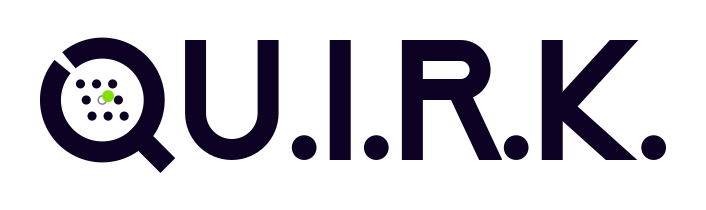
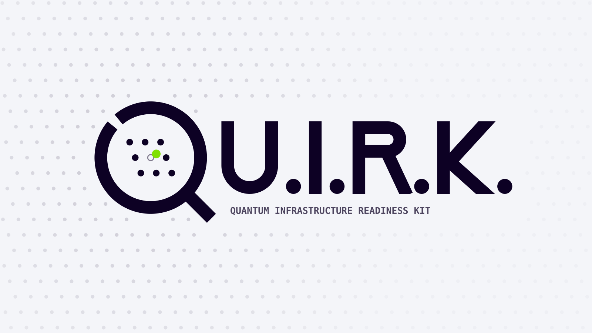

# QU.I.R.K. brand

A scanner lens over a lattice, and the lens is always the Q. The geometry carries six post-quantum easter eggs.

- **[BRAND-GUIDELINES.md](BRAND-GUIDELINES.md)**: the rules (logo system, construction, colour, type, co-branding, don'ts).
- **[brand-sheet.html](brand-sheet.html)**: interactive construction guide.
- **[build_logo.py](build_logo.py)**: generates every SVG here. Don't hand-edit the SVGs; change this and run `python3 docs/brand/build_logo.py`.

The generator takes an optional output directory: `python3 docs/brand/build_logo.py [OUT_DIR]`.

**Public URL contract.** The repo `README.md` loads `quirk-logo.svg` and `quirk-logo-dark.svg` from
`raw.githubusercontent.com` on `main`, and so does the PyPI page of any release built from that
README (the 5.25.0 page predates the logo). Renaming or deleting either of those two files breaks those
pages, so treat their filenames as a public URL contract. `tests/test_readme_brand_logo.py` pins the
exact URLs.

**Rasters.** The report PNG and the dashboard favicon PNG/ICO are produced by `python -m scripts.build_brand_rasters` (resvg-py, dev-only).

**Freshness gate.** `tests/test_brand_assets_freshness.py` fails if any SVG, packaged copy
(`quirk/reports/assets/`, `src/dashboard/src/assets/brand/`, `src/dashboard/public/favicon.svg`),
PNG/ICO raster or `src/dashboard/src/components/BrandLogo.tsx` drifts from its generator.
Regenerate with `python3 docs/brand/build_logo.py`, `python -m scripts.build_brand_rasters`,
`python3 -m scripts.build_brand_component`, the four `cp` copies listed in that test's docstring,
then `cd src/dashboard && npm run build`, and recommit.

| Logo | Mark | Hero |
|---|---|---|
|  |  |  |
